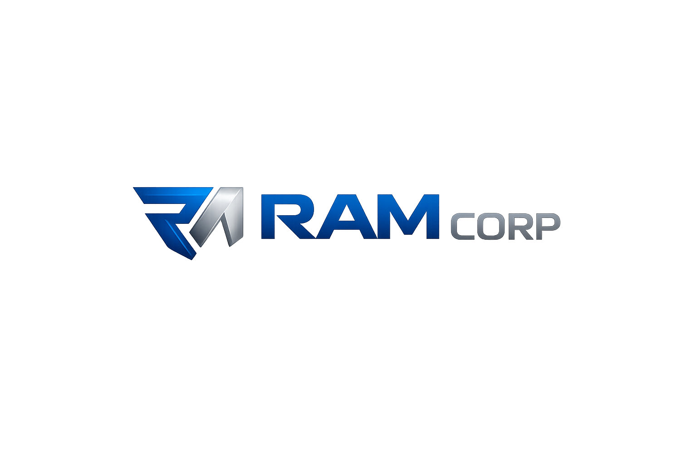

# ✨ byMoments


## 📋 Descripción del proyecto

Es una aplicación web con experiencia adaptable a dispositivos móviles, orientada a crear, personalizar y compartir experiencias digitales para momentos especiales.

Combina herramientas de composición visual, plantillas personalizables y experiencias interactivas para facilitar la creación de contenidos adaptados a distintas ocasiones.

**Objetivos del proyecto:**
- Facilitar la creación de experiencias digitales personalizadas.
- Ofrecer herramientas visuales para diseñar y editar contenidos.
- Brindar una experiencia intuitiva y adaptable a web y dispositivos móviles.
- Integrar gestión de usuarios, almacenamiento y publicación de creaciones.

## 🔍 Características clave

- 🎨 **Editor visual:** composición contextual de texto, imágenes, video, audio y ubicación, con orientación vertical y horizontal.
- 📱 **Diseño adaptable:** experiencia optimizada para pantallas de escritorio y móviles.
- 🧩 **Plantillas por ocasión:** selección y adaptación de diseños para diferentes celebraciones y momentos.
- ✨ **Creación de momentos:** configuración y composición de experiencias digitales.
- 👁️ **Vista previa:** visualización prioritaria del contenido móvil durante la edición.
- 💾 **Gestión de creaciones:** guardado persistente, recuperación de borradores y separación por cuenta.
- 🔐 **Cuentas de usuario:** acceso y gestión de sesiones.
- 📍 **Ubicación:** incorporación de información geográfica y mapas en los momentos.
- 🎁 **Publicación y entrega:** publicación con vigencia y experiencia interactiva de apertura para destinatarios.
- 🌓 **Apariencia:** temas claro y oscuro, con experiencia web progresiva (PWA).
- 🛠️ **Administración:** configuración, gestión de usuarios, estados y sesiones.

## 🛠 Stack tecnológico

**Frontend y experiencia de usuario**


**Backend y servicios**


**Persistencia e infraestructura**


**Plataformas**

 

## 🖥️ Estructura del proyecto

```text
byMoments/
├── frontend/
│   ├── src/
│   │   ├── components/
│   │   ├── auth/
│   │   ├── store/
│   │   ├── hooks/
│   │   ├── services/
│   │   └── styles/
│   └── public/
├── backend/
│   ├── app/
│   └── tests/
├── docs/
├── runtime/
└── scripts/
```

## 🛡️ Derechos de autor y uso

© 2026 **RAM Corp · Julián Alberto Ramírez**.  
Todos los derechos reservados.

**Condiciones de uso:**
- Licencia privada.
- Prohibida la reproducción, distribución o explotación comercial sin autorización expresa.
- Los derechos de terceros sobre tecnologías y dependencias permanecen con sus respectivos titulares.

## 📬 Contacto corporativo
<p align="left">
  
</p>
Ecosistema tecnológico enfocado en ingeniería de software, inteligencia artificial, automatización, infraestructura digital, innovación y desarrollo de productos tecnológicos.


## **Julian Alberto Ramirez**  
🎓 Ingeniero de Sistemas  
💻 Desarrollador Full Stack Senior y ABAP Developer  
🚀 Desarrollo de software, automatización e innovación

📧 [e-mail](mailto:juliram81@hotmail.com)  
🔗 [LinkedIn](https://linkedin.com/in/julianramirezc)  
🌐 [Portafolio](https://jramirez.womosolucions.com/)

---

## 💡 Notas técnicas

Este proyecto está orientado a:

✅ Crear experiencias digitales personalizadas con una interfaz intuitiva.  
✅ Facilitar la composición y edición visual de contenidos.  
✅ Ofrecer una experiencia adaptable a web y dispositivos móviles.  
✅ Integrar servicios, persistencia y gestión de usuarios.

**Tecnología y creatividad para transformar momentos en experiencias digitales.**

---

## 📅 Control de versiones

  
